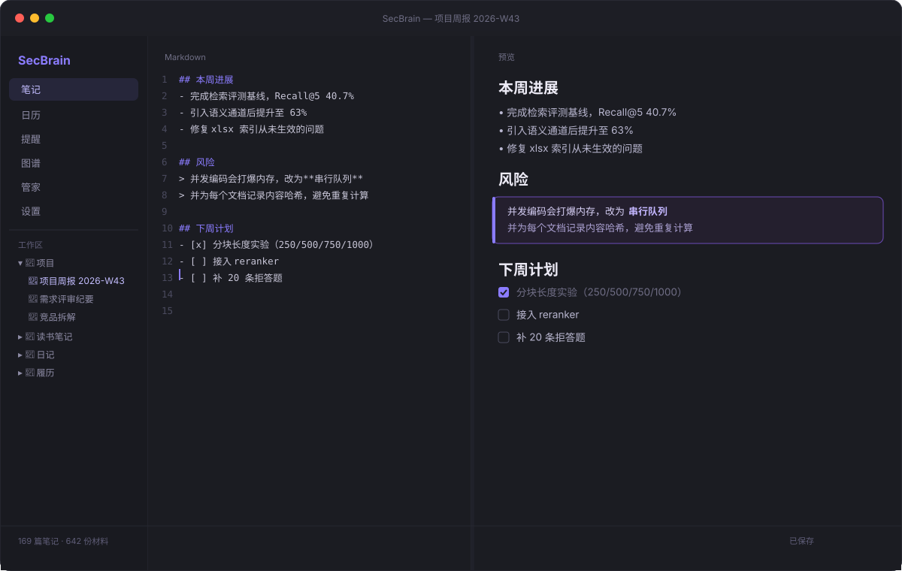
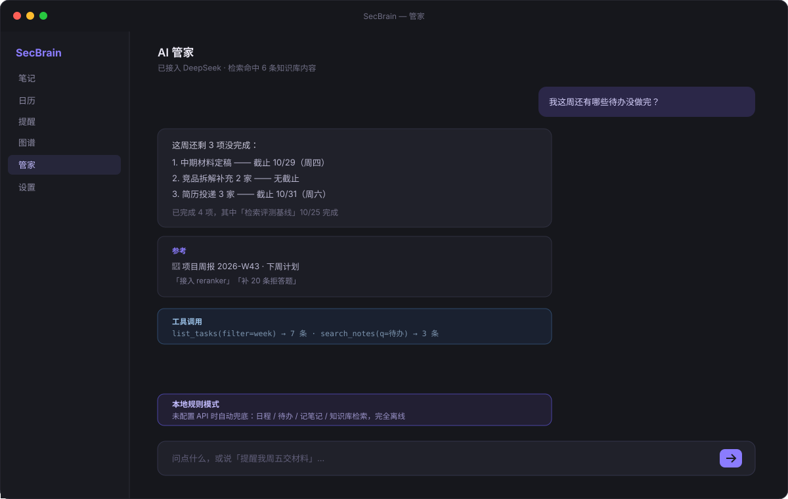
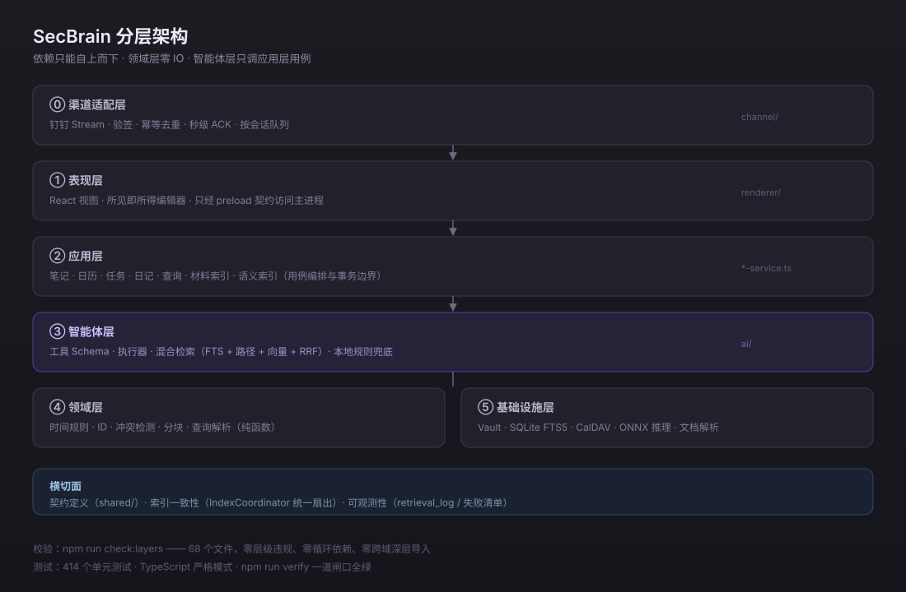

<div align="center">

# SecBrain

**第二大脑（Second Brain）—— 本地优先的知识库 + AI 管家**

把笔记、材料、日程、提醒集中到一处，由本机运行的 AI 统一调度。数据不出本机。

[](https://www.typescriptlang.org/)
[](https://www.electronjs.org/)
[](https://www.sqlite.org/)
[](#工程质量)
[](LICENSE)



</div>

---

## 它解决什么问题

个人资料通常散落在三处：网盘里的简历、微信里的文件、Obsidian 里的笔记。想找一句话，得挨个翻；交给云端 AI，又不敢把日记和薪资记录上传。

SecBrain 的取向很明确：

- **正文是 Markdown 文件**，SQLite 只是派生索引 —— 随时可以带着文件走
- **检索与推理都在本机** —— 向量模型走 ONNX CPU，数据零上传
- **没有 API Key 也能用** —— 内置规则引擎兜底日程 / 待办 / 记笔记 / 检索

## 核心能力

| | 能力 | 说明 |
|---|---|---|
| 📝 | **Markdown 知识库** | Obsidian 兼容（双链、Callouts、KaTeX、Mermaid、Dataview 查询） |
| 👁 | **所见即所得** | 右侧预览单击即可编辑，回车后光标自动跟随回编辑器 |
| 📅 | **日历双向同步** | iCloud CalDAV，支持月/周视图、冲突检测、空闲时段建议 |
| ✅ | **提醒事项同步** | 区分 VEVENT 与 VTODO，勾选完成会回写 iCloud |
| 🔍 | **混合检索** | FTS5 全文 + 路径匹配 + 向量语义 → RRF 融合 |
| 🤖 | **AI 管家** | 工具调用型 Agent：查日程、建事件、管待办、读笔记 |
| 📄 | **材料索引** | docx / pdf / xlsx / pptx 正文提取，642 份可检索 |
| 💬 | **钉钉单聊渠道** | Stream 长连接、幂等去重、绑定码白名单、按会话隔离 |
| 🎨 | **个性化** | 主题、自定义 CSS、编辑器折叠为行号栏、拖拽分栏 |

<div align="center">

</div>

## 架构

<div align="center">

</div>

依赖只能自上而下，**领域层零 IO**，智能体层只调应用层用例。

索引一致性是这套架构的重点：全文、属性、链接图、向量四类索引统一由 `IndexCoordinator` 扇出，单个 provider 失败不阻断其余，但必须记录并可重试——避免"搜索能命中、打开却是旧内容"的幽灵结果。

```
src/
├── main/          Electron 主进程
│   ├── ai/          智能体层：工具 Schema / 执行器 / 混合检索
│   ├── channel/     渠道适配：钉钉 Stream / 幂等 / 队列
│   ├── indexing/    索引一致性：IndexCoordinator + 4 个 provider
│   ├── calendar/    日历与提醒（CalDAV、VEVENT、VTODO）
│   ├── vault/       知识库：文件、笔记、双链、属性
│   ├── semantic/    向量检索：分块、编码、检索
│   └── domain/      领域层：纯规则纯函数
├── preload/       contextoBridge 安全桥
└── renderer/      React 界面
```

## 工程质量

```bash
npm run verify   # 分层检查 + 类型检查 + 全量测试
```

| 指标 | 数值 |
|---|---|
| 单元测试 | **414 个**（39 文件） |
| 分层检查 | **68 个文件**，零层级违规 / 零循环依赖 / 零跨域深层导入 |
| 索引覆盖率 | **99.7%**（1534 / 1539 个可读文件） |
| 检索 Recall@5 | 关键词 40.7% → 混合检索 **63.0%** |
| 拒答正确率 | **61.5%**（13 条"知识库中确实没有"的问题） |

评测集自带 40 条问题（事实 / 汇总 / 拒答三类），`npm run eval:retrieval` 可复现上述数字。

## 快速开始

```bash
npm install
npm run dev        # 开发模式（Vite HMR + Electron）
npm run build      # 构建到 out/
npm run dist:mac   # 打包 macOS dmg（arm64，未签名）
```

首次启动后：设置 → 知识库目录 → 选一个文件夹即可（会自动索引 Markdown 与 docx/pdf/xlsx）。

可选能力：

- **语义检索**：设置 → 语义检索 → 启用（首次下载 bge 模型并建索引，约 5–15 分钟）
- **AI 管家**：设置 → AI 管家 → 选服务商 → 填 API Key → 刷新模型列表
- **本地模型**：装 Ollama 后点「检测本地模型」，自动填入 `127.0.0.1:11434`
- **日历同步**：设置 → 日程账户 → iCloud（用户名 + App 专用密码）

## 技术选型要点

| 决策 | 原因 |
|---|---|
| SQLite `node:sqlite` 而非 better-sqlite3 | 免原生编译，Electron 内置 Node 即可用 |
| 本地 ONNX 向量而非云 API | 数据不出本机，断网可用 |
| RRF 融合而非加权求和 | 不同通道分数量纲不同，RRF 免调参 |
| 分块 750 字 | 对照实验（250/500/750/1000）中召回与排序综合最优 |
| 规则引擎兜底 | 未配置模型的用户也能完成高频操作，避免首屏流失 |

## 数据与隐私

- 笔记正文存 Markdown 文件，数据库只存索引：`~/Library/Application Support/SecBrain/secbrain.db`
- API Key 经系统钥匙串加密，代码中无明文密钥
- 仓库不含任何个人数据：真实评测集放在 `tests/eval/questions.local.json`（已 gitignore）
- 向量模型、`*.db`、导出的 `.ics` 均不进版本库

## 已知限制

- macOS 为主（Windows / Linux 未验证）
- 扫描版 PDF 与图片暂不支持 OCR
- 多设备实时同步依赖 iCloud 日历，笔记本身不同步
- 未上架公证，首次打开需右键「打开」

## Roadmap

- [ ] Reranker（bge-reranker）精排，目标 Recall@5 ≥ 75%
- [ ] 查询改写与父子检索（解决汇总型问题召回）
- [ ] 局域网网页管家（手机浏览器直连，不依赖第三方平台）
- [ ] 扫描件 OCR
- [ ] 自动更新（electron-updater）

## License

[MIT](LICENSE) © 2026 SecBrain Contributors
